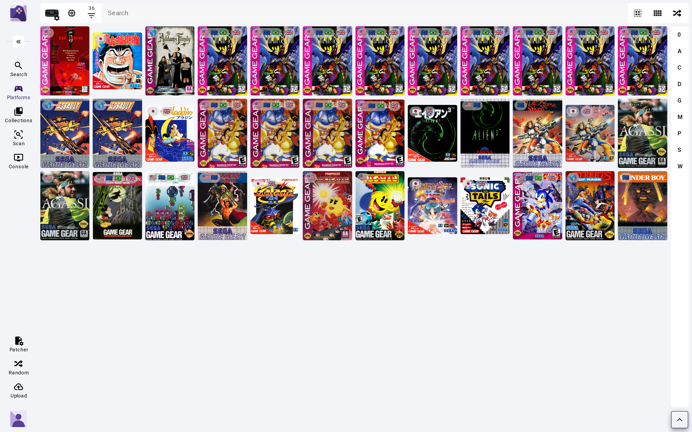

<div align="center">

# 🧩 ROM Hub

**Add new game sources to your retro library — without touching your library server.**

ROM Hub is the plugin engine behind [ROMarr](https://github.com/BlizzHacker/romarr).
Install a plugin and your library can search, import and enrich games from a new
place. It runs beside **RomM**, **Gaseous** or **Retrom** and never changes them.

[](https://github.com/BlizzHacker/rom-hub/actions/workflows/ci.yml)
[](LICENSE)
[](https://github.com/BlizzHacker/rom-hub/stargazers)
[](pyproject.toml)

[Quick start](#-quick-start) · [Plugins](docs/PLUGINS.md) · [60-second tour](docs/SHOWCASE.md) · [Build a plugin in 5 minutes](#️-build-a-plugin-in-5-minutes) · [Technical docs](docs/TECHNICAL.md)



</div>

## 🎮 The family: pick what you need

Three projects that work alone and work better together.

| | What it does | Start here if you want… |
|---|---|---|
| **[Yarr.It](https://yarrit.com)** | One friendly front door for your whole media library: search, stream, play in the browser and on your TV. | a place to *use* your library |
| **[ROMarr](https://github.com/BlizzHacker/romarr)** | The *arr for games. Ask for a game, and it finds it, downloads it and files it into your library, just like Radarr does for movies. | your library to *fill itself* |
| **ROM Hub** *(you are here)* | The plugin engine. Each plugin adds a new source of games, box art or metadata to ROMarr and your library. | *more sources* than anyone ships by default |

```
Yarr.It ──▶ ROMarr ──▶ ROM Hub plugins ──▶ RomM / Gaseous / Retrom
 (watch &     (request &   (new sources,         (your existing
  play)        fetch)       art, metadata)        library server)
```

**Most people should start with ROMarr.** Its *Hub* tab installs and manages
these plugins for you, no command line needed. Use ROM Hub directly when you
run a library server without ROMarr, or when you want to write plugins.

## ✨ What you get

- **More sources, one search.** Search every installed plugin at once and import what you pick.
- **Better-looking libraries.** Plugins fill in box art and metadata your server is missing.
- **Works with your server.** RomM, Gaseous or Retrom. A plugin written once works with all three.
- **Safe by design.** Each plugin runs locked in its own sandbox: no passwords, no file access, and only the websites it declared.
- **Nothing updates behind your back.** Every plugin is pinned to a release; you choose when to upgrade.

## 🎮 Using ROMarr? Start here

Install ROM Hub **into ROMarr's own environment**, then restart ROMarr. Its
*Hub* tab lights up and manages plugins for you. On the Proxmox LXC or a
source install:

```bash
apt-get install -y git
/opt/romarr/.venv/bin/pip install "rom-hub @ git+https://github.com/BlizzHacker/rom-hub@master"
systemctl restart romarr
```

Installing into the system Python, or into a different venv, is invisible to ROMarr.

## 🚀 Quick start

You need **Python 3.12+**.

```bash
git clone https://github.com/BlizzHacker/rom-hub
cd rom-hub
python -m pip install -e .

rom-hub plugin browse                 # see what's available
rom-hub plugin install archive-org    # add a source
rom-hub search "oregon trail"         # search across your sources
```

Searching works straight away. To **import** into your library, point ROM Hub
at your server (RomM, Gaseous or Retrom). [Which library server](docs/TECHNICAL.md#which-library-server)
covers each one.

> **Windows / macOS:** the plugin sandbox is Linux-only. Elsewhere, plugins
> run only if you opt in with `ROM_HUB_ALLOW_UNSANDBOXED=1`.
> [Why, and what that means](docs/TECHNICAL.md#security-model).

## 🔌 Plugins

Browse the directory in **[docs/PLUGINS.md](docs/PLUGINS.md)**: what each
plugin does, what it is allowed to reach, and the terms of the site it reads
from. Want your own directory? `rom-hub catalog add <name> <url>` adds one.

## 🛠️ Build a plugin in 5 minutes

A plugin is a tiny Python package. You describe what to fetch; ROM Hub does the
fetching, sandboxing and talking to the library server. Your plugin works with
RomM, Gaseous **and** Retrom without a single line about any of them.

**`my-source/manifest.toml`** says what the plugin can do and the one site it may reach:

```toml
[plugin]
slug        = "my-source"
name        = "My Source"
version     = "0.1.0"
rpp_version = "1"
license     = "MIT"

[capabilities]
search = "my_source.search:Search"

[permissions]
network  = ["example.org"]
romm_api = []
```

**`my-source/my_source/search.py`** turns a query into results:

```python
from rom_hub_sdk import SearchProvider, SearchResult

class Search(SearchProvider):
    def search(self, query, platform, limit):
        games = self.ctx.http.get("https://example.org/api/games",
                                  params={"q": query}).json()
        return [SearchResult(source_id=str(g["id"]), title=g["name"],
                             platform=g.get("platform"), url=g.get("url"))
                for g in games[:limit]]
```

```bash
rom-hub plugin install ./my-source
rom-hub search "oregon trail"        # your source is now in the results
```

Add `importer`, `metadata` or `stream` capabilities the same way, and ship it.
**[CONTRIBUTING.md](CONTRIBUTING.md)** covers testing and getting it listed in the directory.

### 💡 Plugins we'd love to see

Homebrew sites · fan-translation archives · manual & box-scan libraries ·
museum and preservation collections · your favourite niche platform.
[Open an issue](https://github.com/BlizzHacker/rom-hub/issues) to claim one,
or just send the pull request.

## 📚 Going deeper

Everything technical lives in **[docs/TECHNICAL.md](docs/TECHNICAL.md)**: backends compared,
importing, metadata, streaming, emulator cores and BIOS, the security model
and exactly what it does and doesn't confine, test coverage, and the
[proof matrix](docs/PROOF.md) against live servers.

## 🌐 More from Move Weight

ROM Hub is part of a family of open, self-hostable projects built by
**[Move Weight](https://moveweight.com)**. Use one, or plug them all together.

| Project | What it is |
|---|---|
| 🏴‍☠️ **[Yarr.It](https://yarrit.com)** | One front door for your whole media library: search, stream in the browser, and watch on your TV. |
| 🎮 **[ROMarr](https://github.com/BlizzHacker/romarr)** | The *arr for games: request a title, and it's found, downloaded and filed into your library. |
| 🧩 **[ROM Hub](https://github.com/BlizzHacker/rom-hub)** | The plugin engine behind ROMarr: new game sources, box art and metadata for RomM, Gaseous and Retrom. |
| ⚔️ **[CrypticRealm](https://crypticrealm.com)** | An open-world fantasy RPG that plays right in your browser, with FPS and RTS modes. |
| 🔥 **[Forgeverse](https://forgeverse.org)** | Creative studio apps for game makers: characters, textures and more, with bring-your-own AI. |
| 🥊 **[Galaxy Kombat](https://gk.moveweight.com)** | A 3D fighting game that runs in the browser. |

If one of these is useful to you, a ⭐ on GitHub is the easiest way to help.

## 💬 Help & community

Found a bug or have an idea? [Open an issue](https://github.com/BlizzHacker/rom-hub/issues).
ROM Hub is an independent, unofficial project and is not affiliated with RomM,
Gaseous or Retrom. MIT licensed.
